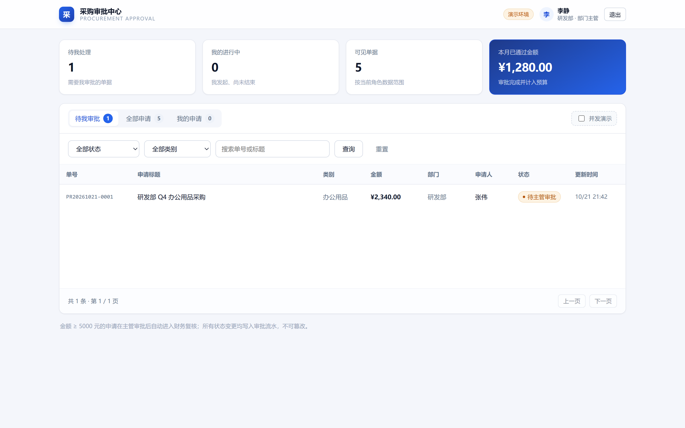

# 采购审批中心 ProcureFlow

企业采购申请与分级审批平台 —— AI Coding 实战案例。

Spring Boot 3 + Vue 3 前后端分离，单 jar 单端口部署，零外部依赖。



---

## 这个项目解决什么问题

采购审批不是"增删改查"，而是**规则密集、边界敏感**的业务：

- 金额 `< 5000` 主管终审，`>= 5000` 必须加一道财务复核 —— **正好 5000 算哪边？**
- 员工只能看自己的单，主管看本部门，财务看全量 —— **接口层面怎么保证？**
- 两个人同时点"通过" —— **会不会产生两条审批记录？**

这三个问题在本项目里都有代码实现 **和** 对应的自动化断言。

## 核心特性

| 特性 | 说明 |
| --- | --- |
| 金额分级审批 | 阈值可配置，`>=` 边界有专门用例锁定 |
| 角色 + 数据范围双控 | 权限在服务层，数据范围进 SQL `where` |
| 乐观锁并发控制 | 同时审批只有一人成功，另一人收到 `409` |
| 审批全留痕 | 每次状态变更写入流水表，只增不改 |
| 统一响应与错误码 | 400/401/403/404/409 语义清晰 |
| 单端口部署 | 前端产物内嵌 jar，`java -jar` 即用 |

## 技术栈

- **后端**：Java 17 · Spring Boot 3.3.5 · Spring Data JPA · Bean Validation · H2
- **前端**：Vue 3.5 · Vue Router 4 · Vite 5（组件自研，无 UI 库）
- **测试**：JUnit 5 · MockMvc · AssertJ（19 个用例）

## 快速开始

```bash
# 方式一：直接运行打包产物
java -jar target/purchase-approval-1.0.0.jar

# 方式二：源码运行
mvn spring-boot:run
```

**Windows 一键启动**：双击 `start.cmd`（优先用 PATH 里的 java，找不到则回退到项目旁的便携 JDK）。

> 注意：这是本地进程，**关掉窗口或重启电脑后服务就停了**，重新双击 `start.cmd` 即可。
> 数据在 H2 内存库里，每次重启都回到初始的 9 条演示数据。

打开 <http://localhost:8080>，使用下方账号登录。

### 演示账号（密码均为 `123456`）

| 用户名 | 姓名 | 角色 | 能看到什么 |
| --- | --- | --- | --- |
| `zhangwei` | 张伟 | 研发部 · 员工 | 自己的 5 张单 |
| `lijing` | 李静 | 研发部 · 主管 | 研发部全部单据，可审批 |
| `wangfang` | 王芳 | 财务部 · 财务 | 全部非草稿单据，可复核 |
| `chenming` | 陈明 | 综合管理部 · 管理员 | 全部单据，可作废 |
| `liuyang` | 刘洋 | 市场部 · 员工 | 自己的 4 张单 |
| `zhaolei` | 赵磊 | 市场部 · 主管 | 市场部全部单据 |

## 测试

```bash
mvn test                          # 19 个 JUnit 用例
node scripts/api-check.mjs        # 26 项接口校验（需服务已启动）
```

当前结果：**JUnit 19/19 通过，接口 26/26 通过**。

## 前端开发

```bash
cd frontend
npm install
npm run dev      # http://localhost:5173，/api 代理到 8080
npm run build    # 产物输出到 src/main/resources/static
```

## 项目结构

```
purchase-approval/
├── src/main/java/com/acme/purchase/
│   ├── common/     统一响应、异常处理
│   ├── config/     配置、拦截器注册、演示数据
│   ├── domain/     实体与枚举
│   ├── repo/       JPA 仓储
│   ├── security/   令牌与登录上下文
│   ├── service/    业务逻辑（含 ApprovalPolicy）
│   └── web/        控制器与 DTO
├── src/test/java/  单元测试 + 集成测试
├── frontend/       Vue 3 工程
├── scripts/        接口校验脚本
└── docs/           设计文档、截图、PPT
```

## 文档

| 文档 | 内容 |
| --- | --- |
| [00-项目介绍](docs/00-项目介绍.md) | 业务场景、核心功能、案例特点 |
| [01-功能规格说明书](docs/01-功能规格说明书.md) | 角色权限矩阵、状态机、12 条需求与验收标准 |
| [02-架构设计](docs/02-架构设计.md) | 分层、6 条架构决策、并发设计、扩展点 |
| [03-数据库设计](docs/03-数据库设计.md) | ER 图、表结构、索引、生产 DDL |
| [04-API接口设计](docs/04-API接口设计.md) | 12 个接口、错误码、调用示例 |
| [05-审查报告](docs/05-审查报告.md) | 设计评审、代码审查、缺陷记录 |
| [06-测试文档](docs/06-测试文档.md) | 45 个用例、覆盖矩阵、复现命令 |
| [07-操作手册](docs/07-操作手册.md) | 启动、演示动线、CloudStudio/云主机部署 |
| [08-AI协作记录](docs/08-AI协作记录.md) | 关键提示词、迭代过程、复盘 |
| [汇报PPT](docs/汇报PPT.pptx) | 15 页汇报稿（含运行截图） |

## 运行截图

| 截图 | 内容 |
| --- | --- |
| `01-login.png` | 登录页与六个演示账号 |
| `02-workbench-manager.png` | 主管工作台（数据范围 + 统计） |
| `03-detail-drawer.png` | 详情抽屉与审批时间线 |
| `04-workbench-employee.png` | 员工工作台 |
| `05-create-form.png` | 新建采购申请 |
| `06-workbench-finance.png` | 财务视角（全部非草稿） |
| `07-workbench-admin.png` | 管理员视角（全量） |

## 已知限制

演示项目的有意取舍，详见《02-架构设计》第 8 节：

- 口令明文、令牌存内存（生产需 BCrypt + JWT/Redis）
- H2 内存库，重启数据重置
- 统计为内存聚合，大数据量需下推 SQL
- `app.demo-mode` 为演示开关，生产必须关闭
